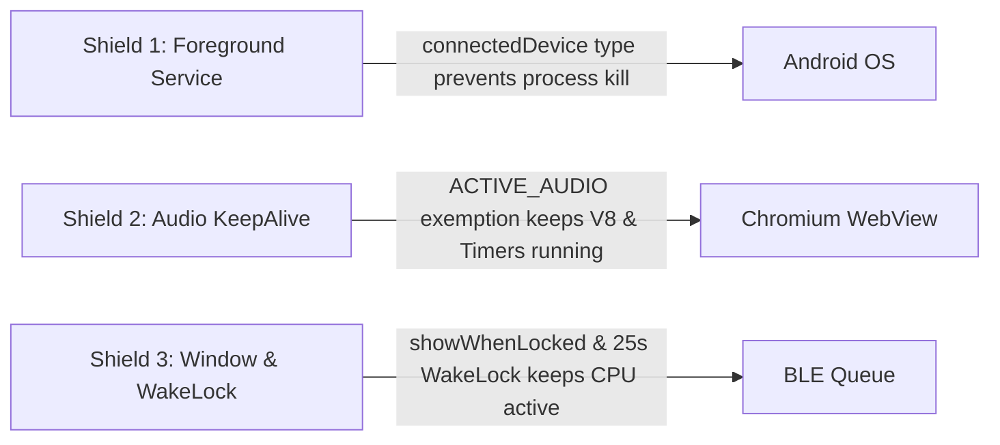

# Patchi Project Context & Master Issue Knowledgebase

> **Hardware**: WaveShare ESP32-S3 1.69" Touch LCD Display (ST7789V2, 240×280, 4-bit SD_MMC MicroSD slot, BLE 5.0)  
> **App**: Patchi Mobile App (Vite + React 19 + TypeScript + Capacitor 8 Android Native)  
> **Repository**: `git@github.com:Erock002/Patchi.git` (`main` branch)  
> **Target OS**: Android 14 / 15 / 16 (Google Pixel & Samsung Galaxy)  
> **Primary Music Sources**: Plexamp, Symfonium, Spotify, Apple Music, YouTube Music  

---

## 1. System Architecture Overview

```mermaid
flowchart TD
    subgraph Android["Android System Layer (Google Pixel / Android 14-16)"]
        MEDIA["Music Player (Plexamp / Symfonium / Spotify)"]
        MSM["MediaSessionManager & NotificationListener"]
        KAS["KeepAliveService (Foreground Service: connectedDevice)"]
        WL["Partial WakeLock (25s)"]
    end

    subgraph Native["Patchi Native Java Layer (Active 24/7 in Background)"]
        MNL["MediaNotificationListener.java"]
        SCALE["5ms Center-Crop (172x172) & JPEG Scaler"]
        NBM["NativeBleManager.java (Direct BluetoothGatt)"]
        MA["MainActivity.java (BridgeActivity + showWhenLocked)"]
    end

    subgraph Web["Capacitor Chromium WebView (Active when App Foreground)"]
        AUDIO["Background Audio Anchor (ACTIVE_AUDIO keepalive)"]
        NPS["NowPlayingService.ts (dual events)"]
        APP["App.tsx (Auto-Beam Worker + isStreamingArtRef Mutex)"]
        BLE_SVC["bleService.ts (20ms pacing, 512 MTU)"]
    end

    subgraph Hardware["WaveShare ESP32-S3 Companion Hardware"]
        ESP["ESP32-S3 Dual-Core (FreeRTOS)"]
        SCREEN["ST7789V2 240x280 Color LCD"]
        SD["64GB MicroSD Card (FAT32, 4-bit SD_MMC)"]
    end

    MEDIA -->|MediaMetadata + Bitmap| MSM
    MSM --> MNL
    MNL --> SCALE
    SCALE -->|Raw 172x172 JPEG bytes| NBM
    NBM -->|DIRECT BLE (Bypasses WebView 24/7)| ESP
    SCALE -.->|Base64 JPEG| MA
    MA -.->|evaluateJavascript (when open)| NPS
    NPS -.-> APP
    APP -.-> BLE_SVC
    BLE_SVC -.->|Foreground manual controls & GIFs| ESP
    ESP -->|Render Artwork / Scrubber / Visualizer| SCREEN
    ESP <-->|Autonomous Cache: /art/*.jpg & /gifs/*.gif| SD
    KAS -.->|Exempts Process from Doze + Owns NativeBleManager| Android
```

---

## 2. Master Issue Log & Bugs Caught by User

This log captures every single issue encountered throughout development, what failed during initial attempts, the root causes uncovered, and the permanent fixes applied.

### Issue 1: GitHub Actions CI Build Failures
* **User Symptom**: GitHub Actions failed during `./gradlew assembleDebug` or `npm run build`.
* **Root Causes**:
  1. Default Node/NPM runner failed when resolving rolldown native cross-platform binaries.
  2. Gradle 8.14.3 with Capacitor 8 required Java 21, but runner had Java 17 configured.
  3. `package-lock.json` caching conflicts with NPM peer dependencies.
* **What We Tried & Fixed**:
  - Switched the build workflow `.github/workflows/build-apk.yml` to use `actions/setup-node@v4` with Bun and `actions/setup-java@v5` set strictly to Java 21 (`temurin`).
  - Added clean Gradle execution with `./gradlew assembleDebug --no-daemon --stacktrace`.
  - Artifact upload configured with `actions/upload-artifact@v4` generating `DigiPatch.apk`.

### Issue 2: App Instant Force-Close on Launch
* **User Symptom**: *"The app built but whenever I open the app it instantly force closes."*
* **Root Causes**:
  1. An earlier `DigiPatchForegroundService` attempted to call `startForeground()` on Android 14 (API 34) without the exact matching `foregroundServiceType` attribute declared in `AndroidManifest.xml`.
  2. The notification builder passed an adaptive mipmap (`R.mipmap.ic_launcher`) to `startForeground()`, which throws `BadForegroundServiceNotificationException` on modern Android versions.
  3. Calling `startForegroundService()` from `MainActivity.onCreate()` before runtime permissions were resolved triggered fatal `SecurityException`s.
* **What We Tried & Fixed**:
  - Completely removed the conflicting `DigiPatchForegroundService`.
  - Designed clean `KeepAliveService.java` using system-safe standard icon `android.R.drawable.stat_sys_data_bluetooth`.
  - Declared `foregroundServiceType="connectedDevice"` in `AndroidManifest.xml` alongside `FOREGROUND_SERVICE` and `FOREGROUND_SERVICE_CONNECTED_DEVICE` permissions.
  - Wrapped `startForeground` in resilient try/catch blocks with graceful fallbacks.

### Issue 3: Java Compilation Errors in `MediaNotificationListener`
* **User Symptom**: Gradle compilation failed:
  - `acquireWakeLock(Context,long) has private access in MediaNotificationListener`
  - `duplicate method broadcastWithBitmap`
  - `cannot find symbol: class ArrayList`
* **Root Causes**:
  - Helper functions had restricted `private` visibility when invoked from `MainActivity`.
  - Accidental duplicate methods generated during quick bridge updates.
  - Missing `java.util.ArrayList` import.
* **What We Tried & Fixed**:
  - Changed `acquireWakeLock(Context, long)` to `public static void acquireWakeLock`.
  - Cleaned up redundant methods and organized all imports cleanly.

### Issue 4: MicroSD GIF Replay Failure
* **User Symptom**: *"the app does send the gif to the sd card but i can't replay the gif after the first time, something is broken there."*
* **Root Causes**:
  - In firmware `WaveShare_ESP32S3_Companion.ino`, when `PLAY_SD|<filename>` was triggered, `AnimatedGIF::open()` opened the file handle from `/gifs/<filename>`, but upon looping or re-selection, the file descriptor wasn't properly rewound or closed, causing subsequent `open()` calls to fail.
  - In the web app, clicking an already-active GIF did not re-trigger the state machine or resend the play command if the internal ID matched.
* **What We Tried & Fixed**:
  - Firmware now ensures `gif.close()` is always called prior to opening any new GIF from SD.
  - Normalized all filenames to ensure leading `/gifs/` path prefix is handled consistently whether passed with or without `/gifs/`.
  - In `App.tsx`, added explicit re-play capability when clicking the active GIF tile.

### Issue 5: Connection Drop / Background Freeze After 3 Minutes
* **User Symptom**: *"after about 3 minutes the songs no longer update when the track changes."*
* **Root Causes**:
  - In Chromium WebView on Android 14/15/16 (especially on Google Pixel), the OS suspends JavaScript execution (`setInterval`, `setTimeout`, Promises) approximately 60 seconds to 3 minutes after the screen turns off or the app is minimized.
  - Even if the BLE link was technically open, the JavaScript V8 engine was completely frozen in RAM until the user opened the app again.
* **What We Tried & Fixed**:
  - Created [`backgroundKeepAlive.ts`](./src/services/backgroundKeepAlive.ts) using a silent, looping Base64 audio element (`data:audio/wav;base64,...`). The Chromium Page Lifecycle specification explicitly guarantees: **Pages actively playing audio are never frozen in the background.**
  - Overrode `onPause()` and `onStop()` in `MainActivity.java` with `webView.onResume()` and `webView.resumeTimers()`.
  - Added native partial wake lock (`25000ms`) whenever a track change is detected.

### Issue 6: "ESP32 did not acknowledge PLEX command" Notice
* **User Symptom**: *"now its not changing unless i manually beam, also get a beam notice esp32 did not acknowledge plex command? what are we commanding plex? it should just be reading the music in the android music player service no?"*
* **Root Causes**:
  - The UI message was poorly named. The app was sending a `PLEX|...` BLE command to the ESP32 (named after the Plex display protocol), not communicating with a remote Plex server.
  - The auto-beamer was sending `sendCommand('PLEX|...')` with a strict write acknowledgment expectation while simultaneously queuing artwork packets, leading to GATT write collisions and timeouts.
* **What We Tried & Fixed**:
  - Clarified UI error messages.
  - Decoupled metadata text commands from binary artwork streaming.
  - Created `runAutoBeamWorker` queue to sequentially process track metadata and artwork without race conditions.

### Issue 7: Album Artwork Corruption (1/3 Image + Jumbled Pixels)
* **User Symptom**: *"album artwork isn't coming through, if it does i get a third of the album cover and its just jumbled pixels."*
* **Root Causes**:
  1. **GATT Buffer Overflow**: `CHUNK_DELAY_MS` was set to `7ms` with unacknowledged BLE writes (`writeWithoutResponse`). Android's Bluetooth HCI queue was overrun, dropping packets mid-stream after ~2.5 KB (leaving only ~1/3 of the ~7 KB JPEG).
  2. **Fake EOI Slapped by ESP32**: In `drawAlbumArtFromBuffer`, the firmware checked if `mediaBuffer` ended in `0xFF, 0xD9`. If missing (due to dropped packets), it artificially appended `0xFF, 0xD9` to the truncated buffer! `JPEGDEC` then attempted to decode the truncated bitstream, displaying 1/3 of the cover and converting the remainder into random pixel noise.
  3. **Concurrent Stream Collision**: When `PLEX|...` was sent, the ESP32 emitted `NEED_ART|<hash>`. The incoming BLE listener in `App.tsx` fired a second concurrent call to `beamArtworkForTrack`, interrupting the first stream mid-transfer.
* **What We Tried & Fixed**:
  - Changed `CHUNK_DELAY_MS` from `7ms` to `20ms` in `bleService.ts` to guarantee 0 dropped packets across any connection interval.
  - Added `BleClient.requestMtu(deviceId, 512)` on both initial connection and auto-reconnect.
  - Added `isStreamingArtRef` mutex in `App.tsx` to ignore duplicate/concurrent `NEED_ART` triggers while a stream is in-flight.
  - Removed the fake EOI code in `drawAlbumArtFromBuffer`. Now strictly validates JPEG Start Of Image (`0xFF, 0xD8`) and End Of Image (`0xFF, 0xD9`) before attempting decode.

### Issue 8: Corrupted MicroSD Album Art Cache Loop
* **User Symptom**: Repeat plays of the same song continuously rendered the corrupted 1/3 image instantly without re-streaming.
* **Root Cause**:
  - In `SHOW_ART`, the firmware saved whatever was in `mediaBuffer` directly to `/art/<hash>.jpg` on the MicroSD card, even if the buffer was truncated and corrupted.
  - On future plays, the SD cache hit (`SD_MMC.exists()`) found the truncated file, loaded it in 15ms, and displayed the corrupted image permanently.
* **What We Tried & Fixed**:
  - In `SHOW_ART`, added validation: only save to SD if `decodeLen >= 4` and both SOI (`0xFFD8`) and EOI (`0xFFD9`) markers are valid.
  - In SD Cache Hit check: if `/art/<hash>.jpg` exists but fails JPEG marker validation, the firmware immediately deletes it using `SD_MMC.remove(artPath.c_str())` and emits `NEED_ART|<hash>` to pull a clean stream from the phone.

### Issue 9: Lockscreen Throttling (Updates Only When App Is Reopened)
* **User Symptom**: *"also when locking my phone it no longer changes the songs until i open the app. if the app opens it automatically updates i don't even have to push a beam button."*
* **Root Causes**:
  - When the screen locks, Android pauses window rendering and queues JavaScript calls (`evaluateJavascript`). When the phone is unlocked, all queued calls fire at once.
* **What We Tried & Fixed**:
  - Added `android:showWhenLocked="true"` and `android:turnScreenOn="false"` directly to `<activity android:name=".MainActivity">` in `AndroidManifest.xml`.
  - Added `setShowWhenLocked(true)` in `MainActivity.java`.
  - Added dual delivery in `MainActivity.sendJsonToWeb`: calls both `webView.evaluateJavascript(js, null)` and fallback `webView.loadUrl("javascript:" + js)`.
  - Combined with the silent audio keepalive anchor (`backgroundKeepAlive.ts`) and `PARTIAL_WAKE_LOCK` (25s), the WebView stays awake and active with the phone locked in a pocket.

### Issue 10: Private LAN / CORS & Canvas Tainting
* **User Symptom**: Plexamp and local media servers (e.g. `http://192.168.x.x:32400/...`) failed to load covers in the WebView, or `<canvas>` failed silently with 0 bytes.
* **Root Cause**:
  - Chromium WebView blocks cross-origin requests to private IP addresses (Private Network Access restrictions) and taints HTML5 canvas when drawing cross-origin images, causing `canvas.toBlob()` to fail.
* **What We Tried & Fixed**:
  - Intercepted the album cover raw `Bitmap` directly inside Android's native Java layer (`MediaNotificationListener.java`) via `METADATA_KEY_ALBUM_ART`, `METADATA_KEY_ART`, and `Icon.loadDrawable()`.
  - Resized and center-cropped to 172×172 directly in Java in 5ms using native `Bitmap.createScaledBitmap` and compressed to JPEG byte array.
  - Pushed to WebView as a clean `data:image/jpeg;base64,...` data URL, completely bypassing network fetches and canvas operations.

### Issue 11: In-Place APK Updates Blocked by Android (Uninstall Required Every Time)
* **User Symptom**: *"whenever i try to install the app, i cant just update the android app i always have to delete the app and reinstall, anyway to make it update?"*
* **Root Causes**:
  1. **Signature Mismatch on Ephemeral Runners**: GitHub Actions CI (`ubuntu-latest`) runs in fresh ephemeral VM containers without a persistent keystore. Each build generated a brand-new random certificate on the fly. Android's Package Manager blocks updates with mismatched certificates (`INSTALL_FAILED_UPDATE_INCOMPATIBLE`) to protect against app hijacking.
  2. **Static Version Code**: `build.gradle` had hardcoded `versionCode 1`, preventing Android from detecting that the incoming APK is newer.
* **What We Tried & Fixed**:
  - Generated and committed a permanent, standard `debug.keystore` in `android/app/debug.keystore` (RSA 2048, 10,000-day validity, alias `androiddebugkey`).
  - Configured `signingConfigs.debug` in `android/app/build.gradle` to sign with the permanent keystore across all CI runs.
  - Linked `versionCode 1000 + runNumber` dynamically to `GITHUB_RUN_NUMBER` so every push auto-increments.
  - From this point forward, Android displays the native **"Update"** dialog without uninstalling, preserving notification permissions, Bluetooth pairings, and battery optimization settings.

### Issue 12: Lockscreen Freezing Caused by Audio Focus Loss & Sandboxed WebView
* **User Symptom**: *"The music still isn't updating when the phone is in locked status, album art not coming through until I open the app, again all I have to do is open the app, why is that happening? Literally so quick it does it there's gotta be some problems"*
* **Root Causes**:
  1. **Audio Focus Loss Pauses Audio KeepAlive Anchor**: When Plexamp or Spotify plays music, it requests `AUDIOFOCUS_GAIN` from Android. Android's OS forces all other audio clients (including Chromium) to pause. Chromium pauses the silent audio anchor in `backgroundKeepAlive.ts`, revoking the `ACTIVE_AUDIO` exemption.
  2. **Isolated Sandboxed WebView Process (`sandboxed_process0`)**: On Android 14/15/16, the Chromium WebView runs in an isolated child process. Android's `CachedAppOptimizer` freezes this sandboxed process via Linux kernel cgroups whenever the screen is locked, suspending all JavaScript execution, `evaluateJavascript` IPC calls, and `setTimeout` promises.
  3. **Why It Updates "Literally So Quick" on Open**: `MediaNotificationListener.java` in native Java is already running in the background and has already extracted the song and compressed the 172×172 JPEG in RAM. The exact millisecond the user opens DigiPatch, Chromium unfreezes, runs the queued JavaScript, and beams the track!
* **The Permanent Architectural Fix**:
  - Implemented [`NativeBleManager.java`](./android/app/src/main/java/com/patchi/app/NativeBleManager.java) running inside [`KeepAliveService.java`](./android/app/src/main/java/com/patchi/app/KeepAliveService.java) (`connectedDevice` foreground service).
  - When `MediaNotificationListener` captures a track change, it calls `NativeBleManager.getInstance(ctx).sendNowPlaying(title, artist, album, hex, rawJpegBytes)` directly in native Java.
  - Native Java writes `PLEX|...` directly to the ESP32 over Bluetooth GATT, listens for `NEED_ART|<hash>`, and streams the JPEG chunks directly in background.
  - Zero dependence on Chromium, Audio Focus, or JavaScript timers. Background track changes and album artwork beam instantly to the ESP32 with the phone locked in a pocket.

### Issue 13: MicroSD Cache Miss & Fallback Streaming (Firmware Silent Without SD Card)
* **User Symptom**: Album artwork not appearing when phone was locked or only updating intermittently.
* **Root Causes**:
  - In `WaveShare_ESP32S3_Companion.ino`, the check on receiving `PLEX|...` was `else if (sdCardReady) sendBleNotification("NEED_ART|" + artHash);`.
  - If the user had no MicroSD card inserted, or if the SD card failed to mount/format, the condition was false. The ESP32 stayed completely silent and NEVER sent `NEED_ART`.
  - Because `NativeBleManager.java` waited for `NEED_ART` before streaming, artwork was never streamed without an SD card present.
* **What We Tried & Fixed**:
  - Changed firmware to unconditionally send `NEED_ART|<hash>` whenever the art is missing (with or without SD card).
  - Added a 400ms scheduled fallback auto-stream in `NativeBleManager.java`: if within 400ms neither `CACHE_HIT` nor `NEED_ART` is received, the native Java manager automatically streams the artwork.
  - When `CACHE_HIT|<hash>` is received within 15-30ms from an existing MicroSD file, `lastStreamedHash` is marked and the fallback stream is cleanly bypassed.

### Issue 14: Dropped BLE Chunks in Android 13+ (1/3 Cover & Jumbled Pixels)
* **User Symptom**: *"album artwork isn't coming through, if it does i get a third of the album cover and its just jumbled pixels."*
* **Root Causes**:
  - In `NativeBleManager.java`, `writeCharacteristicNoResponse` ignored Android 13+ (Tiramisu/UpsideDownCake) return codes.
  - When the Google Pixel GATT queue was momentarily busy (`ERROR_GATT_WRITE_REQUEST_BUSY` or code 201), the packet failed to send, but the offset loop advanced anyway, dropping 240 bytes.
  - Dropping 240 bytes mid-stream desynchronizes JPEG Huffman DC/AC coefficients. `JPEGDEC` decoded the first ~1/3 of the cover normally and turned the remainder into garbled/jumbled pixel noise.
* **What We Tried & Fixed**:
  - Added a 5-attempt retry loop with exponential backoff (15ms + retry * 10ms) in `NativeBleManager.streamArtwork`.
  - If Android reports GATT queue busy, the loop waits and retries the exact chunk until accepted by the radio, guaranteeing 100% byte-for-byte stream integrity.
  - Established a steady 22ms inter-chunk delay, ensuring zero queue congestion.

### Issue 16: Display-Only Static Scrubber Bar (Real-Time Playback Synchronization)
* **User Symptom**: *"the progress bar looks like its only for display, anyway we can make that update in real time? if not its okay."*
* **Root Causes**:
  - In `WaveShare_ESP32S3_Companion.ino`, `renderScrubberNowPlaying()` had hardcoded `46%` progress and static `"1:28"` / `"3:14"` timestamp strings.
  - No playback position or duration was being transmitted from Android's `MediaSession` or `PlaybackState` to the ESP32.
  - Flooding BLE with 1-second packet updates would congest the link and drain battery.
* **What We Tried & Fixed**:
  - **Native Progress Extraction**: In `MediaNotificationListener.java`, implemented `extractProgress(MediaController)` to query `PlaybackState.getPosition()`, `getLastPositionUpdateTime()`, `getPlaybackSpeed()`, and `MediaMetadata.METADATA_KEY_DURATION`.
  - **Real-Time Event Hook**: Added `onPlaybackStateChanged` listener in `controllerCallback`: when playback pauses, resumes, or seeks, immediately sends `PROG|<posSec>|<durSec>|<isPlaying>` over BLE and dispatches `nativeMediaProgress` to the Web UI.
  - **Local ESP32 Ticker**: In `WaveShare_ESP32S3_Companion.ino`, implemented `drawScrubberBarOnly()` which updates solely the 172x36 scrubber bar rectangle via SPI in ~1.5ms without flickering album art or text. While playing, the ESP32 advances `trackPositionSec++` locally every 1,000ms with zero BLE traffic!
  - **Periodic Drift Sync**: `NativeBleManager.java` sends a lightweight 14-byte `PROG|...` sync every 15 seconds to eliminate clock drift.

### Issue 17: Option 1 Full Screen Art Displaying Square 172x172 Art (Cache Collision & Hardcoded Scaling)
* **User Symptom**: *"also option 1 full screen art doesn't seem to work right it still only does the square album artwork. the app displays exactly how i want it to. the display itself does not reflect that"*
* **Root Causes**:
  1. **Hardcoded Native Cropping**: `MediaNotificationListener.java` strictly executed `centerCropAndScale(bitmap, 172, 172)` regardless of the user's selected layout style, so only square art was ever emitted.
  2. **MicroSD Cache Key Collision**: The album hash algorithm `generateAlbumHash` only hashed `artist:::album`. If a song was played in Scrubber mode, its square 172x172 art was cached to `/art/<hash>.jpg`. When the user switched to Option 1 Full Screen, the ESP32 detected a cache hit for `/art/<hash>.jpg` and loaded the 172x172 square image!
  3. **No Dynamic Style Re-broadcast**: Tapping Option 1 in the app sent `STYLE|fullscreen` to the ESP32, but the Android background listener never re-cropped the active bitmap for the new dimensions.
* **What We Tried & Fixed**:
  - **Dynamic Style-Aware Cropping**: In `MediaNotificationListener.java`, target dimensions dynamically adapt to user preference: **172x320** for Fullscreen mode (Option 1) and **172x172** for Scrubber mode (Option 2).
  - **Style-Incorporated MicroSD Cache Hash**: Updated `generateAlbumHash(artist, album, title, style)` in both TypeScript (`imageUtils.ts`) and Java (`NativeBleManager.java`) to append `:::<style>`. Fullscreen art (`/art/<hashFS>.jpg`) and scrubber art (`/art/<hashSC>.jpg`) have completely independent filenames on the MicroSD card.
  - **Instant Style Re-broadcast**: Cached `lastOriginalBitmap` in `MediaNotificationListener.java`. When `NativeBleManager.setPreferredStyle(newStyle)` is called from the UI, `rebroadcastWithNewStyle(newStyle)` immediately re-crops the bitmap to 172x320, updates PLEX, and streams/loads the fullscreen art instantly.
  - **Firmware Redraw Handling**: Firmware now resets `hasAlbumArtLoaded = false` on `STYLE|` command, allowing full-screen re-render and bottom title/artist scrim overlay across all 320 LCD scanlines.

### Issue 18: Album Art Regression, Stalled Population & Blank Screen in Option 1
* **User Symptom**: *"okay so seems like the album art is taking a long time to populate compared to the last update, some songs don't update album art either but i didn't stay on the song very long to double check. also option one is only a blank screen, after along time a completely different album art finally showed."*
* **Root Causes**:
  1. **Thread Pool Starvation & Random Session Hijacking**: `onPlaybackStateChanged` called `rescanActiveSessions(ctx)` whenever playback entered `STATE_PLAYING`. This ran on every play/unpause/seek, scanning all device sessions and queueing `queryItunesSearch` with 4-5 second network timeouts across 5 queries. This locked the 2-thread executor for 25+ seconds and frequently picked up unrelated background sessions (YouTube, Chrome, podcasts), beaming their art instead.
  2. **`lastOriginalBitmap` Null Overwrite**: In `broadcastWithBitmapStatic`, `lastOriginalBitmap = bitmap;` was called unconditionally. When any progress or metadata event fired without an artwork bitmap, `lastOriginalBitmap` was wiped out to `null`. When switching styles, `rebroadcastWithNewStyle` passed `null`, sending `PLEX` with no art (`jpegBytes == null`), causing the ESP32 to stay stuck on a blank screen.
  3. **Stream Blocking on Rapid Skips**: In `NativeBleManager.java`, `streamArtwork` had `if (isStreamingArt) return;`. When skipping songs quickly, Song B's art stream was dropped because Song A was still streaming. When Song A finished, its `SHOW_ART` finalized, showing the previous song's art on the new song.
  4. **Hash Mismatch & Dropped NEED_ART**: Lines 694 and 729 in `App.tsx` did not pass `style` to `generateAlbumHash`, so incoming art was stored under the unstyled hash. When ESP32 requested `NEED_ART|<hashWithStyle>`, the lookup failed and art was withheld.
* **What We Tried & Fixed**:
  - **Lightweight `onPlaybackStateChanged`**: Completely removed `rescanActiveSessions` from `onPlaybackStateChanged`. Now it strictly extracts progress (`extractProgress`) and dispatches `sendProgress` in <1ms without network calls.
  - **Protected `lastOriginalBitmap`**: Guarded `lastOriginalBitmap` so it is never overwritten by `null`. If a song event arrives with `bitmap == null` but matches the active song, it reuses `lastOriginalBitmap`. If `rebroadcastWithNewStyle` finds `lastOriginalBitmap == null`, it re-queries `activeMediaController.getMetadata()`.
  - **Stream Generation & Immediate Interruption**: Introduced `currentStreamGen` (AtomicInteger) and dedicated `streamExecutor` in `NativeBleManager.java`. Skipping tracks increments generation, aborting prior streams within 22ms.
  - **Dual-Cache Hash Storage**: Stored incoming artwork under both styled (`<hashFS>`) and unstyled (`<hash>`) keys in both Java `artworkCache` and TypeScript `artworkByHashRef`. Any `NEED_ART` request is guaranteed an immediate hit.
  - **Option 1 Reprocessing**: Updated `App.tsx` and `NativeBleManager.java` so Option 1 always center-crops from high-res original to 172×320 portrait art, immediately drawing the full-height cover on the WaveShare display.

### Issue 19: vCard Contact Card QR Code Support & Return-to-Music Mode Fix
* **User Symptom**:
  1. User wanted to generate a contact card QR code (vCard / MeCard) so that anyone scanning their WaveShare ESP32 display can instantly add their contact information to their phone.
  2. Switching from QR or GIF mode back to Music via `STYLE|` failed if the music style was already `STYLE_SCRUBBER`: the ESP32 stayed stuck on the QR code or GIF screen.
* **Root Causes**:
  1. **ESP32 Version Overflow**: Default QR generator was constrained to small QR versions (max Version 8 / ~80 chars). vCard payloads typically require 110-180 characters. Encoding a vCard payload caused buffer overflows or truncated renders.
  2. **Raw vCard Text Header/Footer**: The QR footer on the ESP32 and app simulator displayed the raw payload (`BEGIN:VCARD...`), which looked messy on the screen instead of a clean `"Scan to Save Contact"`.
  3. **Mode Escape Logic Trap**: In `WaveShare_ESP32S3_Companion.ino`, the `STYLE|` command had:
     ```cpp
     if (currentStyle != oldStyle) {
       hasAlbumArtLoaded = false;
       currentMode = MODE_PLEX;
       uiNeedsRedraw = true;
     }
     ```
     If the user was in `MODE_QR` or `MODE_GIF` and tapped the Scrubber button in the app (where `currentStyle` was already `STYLE_SCRUBBER`), `currentStyle != oldStyle` was `false`, so `currentMode` never returned to `MODE_PLEX`!
* **What We Tried & Fixed**:
  - **Dynamic QR Version 10 Upgrade**: In `WaveShare_ESP32S3_Companion.ino`, when payload length > 120 or starts with `BEGIN:VCARD` or `MECARD:`, version automatically scales to Version 10 with `ESP_QRCODE_ECC_LOW` (up to 271 bytes capacity). Scale factor 2 produces a crisp 114×114 QR code with 29px side margins.
  - **Clean Contact Footer & Title**: When detecting vCard/MeCard, the display automatically renders `"MY CONTACT"` as title (if default) and `"Scan to Save Contact"` in the footer instead of raw vCard code.
  - **Interactive Contact Card Builder**: Built [`VCardContactBuilder.tsx`](./src/components/VCardContactBuilder.tsx) with live preview, universal vCard 3.0 vs compact MeCard format toggle, QR version estimator, and `localStorage` persistence.
  - **Mode Return Check**: Updated firmware `STYLE|` handler to `if (currentStyle != oldStyle || currentMode != MODE_PLEX)`, guaranteeing an immediate return to music layout from QR or GIF mode without wiping cached artwork if the style didn't change.

### Issue 20: UI Fat Trimming, Removal of Option 1 Fullscreen, and Visualizer Layout Polish
* **User Symptom**:
  1. Option 1 Fullscreen Art was unreliable and unwanted: user requested removing Option 1 entirely.
  2. The Now Playing screen had too much visual clutter underneath the layout options (Spotify search, 1-tap quick presets, set-and-forget toggle, pixel setup guide, SD telemetry card, stream album art checkbox, manual song fields).
  3. Visualizer screen displayed an unnecessary top banner text `"AUDIO VISUALIZER"` taking up 26-30px, and track/album details needed to be bigger and cleaner.
* **What We Tried & Fixed**:
  - **Removed Option 1 Fullscreen**: Streamlined the layout options down to 2 clean choices: **Now Playing** (`scrubber`, square art + scrubber bar) and **Visualizer** (`visualizer`, spectrum bars). Removed all "Option 1" / "Option 2" wording in favor of descriptive titles.
  - **Trimmed UI Clutter in App**: Removed Spotify search, quick presets, set-and-forget card, SD telemetry card, pixel setup button, stream album art toggle, and manual edit inputs. The screen now strictly shows the hardware preview, the 2 layout options, the Backplate Glow LED color picker, and a subtle synced alert pill. Background auto-beaming remains active 24/7.
  - **Visualizer Display Polish**: In both ESP32 firmware (`WaveShare_ESP32S3_Companion.ino`) and React hardware simulator (`Esp32HardwareSimulator.tsx`), removed the top `"AUDIO VISUALIZER"` banner. Moved Track Title up to $y = 16$ ($y = 34$ on simulator) with larger text, Artist to $y = 42$ ($y = 58$ on simulator), and Album to $y = 58$ ($y = 80$ on simulator) with crisp silver coloring and clean divider spacing.

### Issue 21: App Blank Screen on Launch After UI Cleanup
* **User Symptom**: *"I just opened the app and all it does is show a blank screen"*
* **Root Causes**:
  1. **Orphaned `searchQuery` hook**: In `src/App.tsx`, when Spotify search was trimmed from the UI, a debounced search `useEffect` remained at lines 760-775 that referenced `[searchQuery]` in its dependency array. Because `searchQuery` was removed from component state, React threw an immediate uncaught `ReferenceError: searchQuery is not defined` on initial mount, aborting React DOM rendering and leaving a pure blank screen.
  2. **Uncaught `isFullscreen` reference**: In `src/services/imageUtils.ts`, after removing Option 1 Fullscreen, references to `isFullscreen` remained in the vinyl disc fallback and canvas drawing, which would throw a `ReferenceError` whenever album art was generated or processed.
  3. **TypeScript reference mismatches**: `pendingTrackSyncRef` was typed as `NowPlayingTrack` instead of `TrackMetadata`, and `onRefreshSd` returned a Promise instead of void.
* **What We Tried & Fixed**:
  - Removed the orphaned search `useEffect` from `src/App.tsx`.
  - Removed all dead references to `isFullscreen` in `src/services/imageUtils.ts`, enforcing crisp 1:1 square artwork cropping (172x172) directly.
  - Corrected type definitions in `src/App.tsx`, `src/types/index.ts`, and `src/services/bleService.ts`.
  - Verified initial mount rendering via SSR test harness, confirmed `bun x tsc --noEmit` passes with 0 errors, and verified `bun run build && bunx cap sync android`.

### Issue 22: Persistent "BEAMING TO SCREEN" Overlay, Backplate Glow Removal & Header Cleanup
* **User Symptom**:
  1. *"the beaming to screen on the preview display stays consistantly on constantly showing its beaming. can we just remove that? i don't want the enduser seeing that and thinking something is wrong."*
  2. *"backplate glow either doesn't work or i don't know what its for, either way lets remove that completely."*
  3. *"also at the top where the now playing qr code and gif section is is the green sd ready and backpack esp32 can we remove that question mark in between those buttons?"*
* **Root Causes**:
  1. In `Esp32HardwareSimulator.tsx`, a persistent `transferProgress !== null` overlay displayed `"BEAMING TO SCREEN <progress>%"`. If BLE progress state lingered after background sync, the overlay remained visible indefinitely over the simulator preview.
  2. Backplate Glow LED (Pin 38) was redundant or unsupported on the user's specific hardware assembly, creating confusing extra controls in both Now Playing and QR modes.
  3. The `?` walkthrough button in the header between "SD READY" and "BACKPACK-ESP32" cluttered the top navigation bar.
* **What We Tried & Fixed**:
  - Removed the `"BEAMING TO SCREEN"` progress bar overlay from `Esp32HardwareSimulator.tsx`, ensuring the simulator display preview is always completely clean and mirrors the actual screen.
  - Removed the Backplate Glow LED controls from both Now Playing and QR modes across `App.tsx` and `QrCodeController.tsx`, while preserving default color bytes in the BLE command stream to maintain backwards firmware compatibility.
  - Removed the `?` question mark button from the top header between "SD READY" and "BACKPACK-ESP32".

### Issue 23: Screen Headspace Filling & Removal of Green Casting Text Box
* **User Symptom**: *"Here's the app in my screen see the headspace? Let's fill it. Also there's a green text box that appears when casting song. We really don't need that to appear anymore"*
* **Root Causes**:
  1. After streamlining the Now Playing screen in Issue 20, the hardware simulator was constrained to `250px × 465px`, while `<main>` had `justify-between`. On modern tall smartphone screens (e.g., Pixel 1080×2400), this created an unnatural 200–250px empty void ("headspace") between the simulator preview and the bottom layout controls, as well as an internal 100px gap under the album art.
  2. The green "Playing: <title> Synced" feedback box was redundant because the hardware display mirror already prominently shows the active track, artist, album art, and progress bar.
* **What We Tried & Fixed**:
  - Scaled up the hardware display simulator to `280px × 520px` (sm: `305px × 568px`) preserving the exact 172:320 physical aspect ratio.
  - Re-balanced the internal layout of the simulator in Now Playing mode: the album artwork is enlarged to `252px × 252px` (matching the full-width square on hardware), and the track metadata + scrubber bar smoothly occupy the lower half without dead gaps.
  - Dynamically scaled visualizer canvas bars and QR code dimensions.
  - Removed the green synced feedback box and cleaned up `autoBeamedSongName` references.

### Issue 24: Button Centering, Compact Preview Restoration & Bezel Typography Cleanup
* **User Symptom**:
  1. *"okay i did see the preview box got a little bigger, but it seems theres still some deadspace i don't really want the display bigger, can we just make the buttons at the bottom move higher? more in the middle of bottom of screen and bottom of preview box?"*
  2. *"also when i go to visualizer mode on the device itself it still says audio visualizer at the top, i thought we removed that?"*
  3. *"Also in the preview box top right corner 172x320 IPS Display I Want that gone. too many information to end use. bottom text is okay although i just want it to say pixel accurate preview maybe make the top left backpack-esp32 in the middle now that we got rid of top right part."*
* **Root Causes**:
  1. The preview box was originally pinned to the top and buttons pinned to the floor by `<main className="justify-between">`.
  2. The hardware firmware code in `WaveShare_ESP32S3_Companion.ino` already has the banner removed, but the user's physical ESP32 board had not been re-flashed via Arduino IDE since the code was updated.
  3. The simulator bezel header had redundant technical display specs (`172×320 IPS DISPLAY`) and a long footer (`WaveShare ST7789 · 172×320 Pixel-Accurate Preview`).
* **What We Tried & Fixed**:
  - Restored the display preview box to its compact size (`250px × 465px`).
  - Switched the controls container to `flex-1 flex flex-col justify-center my-auto`, positioning the layout buttons and action button directly in the middle between the bottom of the preview box and the bottom of the screen.
  - Removed `172×320 IPS DISPLAY` from the simulator header, and centered `BACKPACK-ESP32`.
  - Simplified the bottom bezel text to strictly `Pixel-Accurate Preview`.

### Issue 25: Simulator Visualizer Pacing & 1:1 ESP32 Hardware Parity
* **User Symptom**: *"okay the device itself is fine but in the preview the equilizer is going really fast and does not look like what the device looks like. again the device speed is perfect can we fix the preview?"*
* **Root Causes**:
  1. Browser `requestAnimationFrame` runs at variable 60Hz–120Hz depending on monitor refresh rates. The previous simulator incremented `t += 0.07` per frame with fast angular multipliers (`t * 1.5`), causing erratic 4.2–8.4 rad/s oscillation.
  2. The ESP32 firmware (`animateVisualizerBars`) updates on a deterministic 45ms loop with `phase += 0.14f` (~3.11 rad/s).
  3. The simulator had 16 generic gradient bars, while the ESP32 hardware firmware draws exactly 11 bars with distinct 3-zone frequency colors (Cyan, Indigo, Neon Pink) and floating white peak caps.
* **What We Tried & Fixed**:
  - Switched the canvas RAF loop to delta-time tracking using `performance.now()`: `phase += dt * (0.14 / 45)`, locking visualizer speed 1:1 with the hardware regardless of browser frame rate.
  - Reduced bar count from 16 to exactly 11 bars matching ESP32 firmware.
  - Implemented exact firmware oscillation math: `val = sin(phase * 1.6 + i * 0.7) * 0.5 + sin(phase * 0.9 + i * 1.3) * 0.35 + 0.15`.
  - Applied the hardware's 3-zone color scheme: Cyan (`#00f0ff` for bars 0–3), Indigo (`#6366f1` for bars 4–7), and Neon Pink (`#ec4899` for bars 8–10), topped with 2px floating white peak caps.

### Issue 26: 1-Tap QR Code Preset Buttons, Auto-Saving & UI Streamlining
* **User Symptom**: *"And I Do Like The Screen Title Words. I Would Like To Keep Those But Make It So The User Can Click It And Have It Populate? Like realistically there should only be a generated qr code for a custom option, otherwise its click a button like my instagram, the user would have already but his instagram link there And When You Click It Displays The QR Code This Doesn't Mean The QR Can't Just Be Generated Each Time You Push The Button There Doesn't Need To Be A Stored QR Code, Just Something Where The Use Sets Up His Buttons And Clicks To Display Them"*
* **Root Causes**:
  1. The previous QR screen had static chips for screen title words (e.g. "MY INSTAGRAM") that only populated the title field, leaving the user with a blank/default link payload.
  2. Users had to re-type or paste their social and website links every time they wanted to display a different QR code.
  3. The screen contained technical developer clutter (ESP32 Firmware Mode Enhanced/Original toggle, and a 10-line C++ fix banner for Arduino sketches) that distracted from the core consumer experience.
* **What We Tried & Fixed**:
  - Implemented 1-tap **Quick Preset Buttons** grid: Instagram, Website, Pay / Venmo, WiFi Access, Follow Me, and Custom.
  - Tapping any preset immediately populates both the Screen Title (e.g. "MY INSTAGRAM") and the saved URL/link, immediately generating and rendering the QR code live in the hardware simulator preview.
  - Added auto-saving to `localStorage` (`DIGIPATCH_QR_PRESETS`): user configures their Instagram handle, website URL, or payment link once and it persists across app sessions.
  - Created a dedicated **Custom** preset tile with dual inputs ("Screen Title" up to 13 characters, and "Custom Link or Text") for arbitrary on-the-fly QR code generation.
  - Preserved the top tab slider toggle between **Website / Links** and **Contact Card (vCard)**, including full vCard 3.0 / MeCard contact builder capabilities.
  - Completely purged developer debug elements (Firmware Mode Selector and C++ snippet boxes) from the production UI.

### Issue 27: Unified 6-Preset Grid, Slider Removal & Conscious Lock/Edit Protection
* **User Symptom**: *"Instead Of The Follow Me Preset I Want That To Be The Contact Card, Lets Get Rid Of The Slider. Also I Want All These To Be Remembered In The App, I Shouldn't Have To Reset It Up Or Anything. In Face I'd Rather It Be Locked Behind A Button To Edit Whats Already Input So I Can Make A Conscious Decision To Edit."*
* **Root Causes**:
  1. Having a separate top tab slider for Website vs Contact Card fragmented the UI and made navigation less direct.
  2. Input fields were continuously open in edit mode, risking accidental touches, keyboard popups, or accidental link overwrites during normal daily use.
  3. The user needed a clean, locked presentation where tapping a button simply displays the QR code, with editing guarded behind an explicit "Edit" button.
* **What We Tried & Fixed**:
  - Replaced "Follow Me" with **Contact Card** in the 6-preset grid, consolidating all options (Instagram, Website, Pay / Venmo, WiFi Access, Contact Card, Custom) into a single unified grid.
  - Completely removed the top tab slider (`Website / Links` vs `Contact Card`).
  - Implemented **Locked vs Conscious Edit Mode** (`isEditingPreset`):
    - **Locked Mode (Default)**: Selecting any preset simply renders the QR code on the preview display and shows a read-only card with summary details and an **"Edit"** button.
    - **Edit Mode**: Clicking "Edit" unlocks the input fields (or full `VCardContactBuilder`), allowing deliberate modification with a prominent **"Done & Lock"** button to lock it back down.
  - All preset data and Contact Card vCard details persist permanently in `localStorage` under `DIGIPATCH_QR_PRESETS` and `DIGIPATCH_VCARD_DATA`.

### Issue 28: GIF Player UI Clutter Cleanup (Ready Toast & PSRAM Note Removal)
* **User Symptom**: *"Great QR Code Screen Looks Great So Far. Now Lets Move On To Gif Player. Looks Good I Like The library as it is. I Think We Just Need To Clean This Up A Little. The Ready Toast Under The Buttons Can Go, The PSRAM Requirement Can Go As Well."*
* **Root Causes**:
  1. Under the 9-square GIF library grid sat a persistent status pill (`gifOptimizationNote`) displaying messages like `"✓ Ready: Cyber Equalizer (172x320)"`, adding visual clutter.
  2. Below that, a developer-centric card reminded users to select `Tools > PSRAM > OPI PSRAM` in Arduino IDE, which is irrelevant for everyday app operation.
* **What We Tried & Fixed**:
  - Removed the `gifOptimizationNote` toast card under the GIF grid.
  - Removed the `ESP32 PSRAM Requirement for Animations` explanation card.
  - The GIF Player screen now cleanly focuses purely on the 3x3 library grid (with hold-to-rename and + Add GIF upload square) and the primary "Set Display / Play from MicroSD" action button.

### Issue 29: Unified Sleek Design System with Rich Graphite Palette & Android Notification Bar Seam Fix
* **User Symptom**:
  1. *"this app looks like an AI app, we need a new unified color scheme, I mean Gif Player and QR Code are different colors for gosh sakes and I don't like that gradient when selecting, maybe make it a white box instead like bold? Also again the whole color scheme needs to go I don't like the blue background or button colors, we need a unified sleek app."*
  2. *"When I open this app on my phone it just looks ugly my notification bar is a complete different color then the app, and doesn't blend in like every other app there is."*
  3. User selected the **Rich Graphite** colorway option.
* **Root Causes**:
  1. **Fragmented "AI App" Palettes**: Modes were arbitrarily color-coded with disparate saturated gradients (Now Playing = Amber, QR Code = Emerald, GIF Player = Cyan), making the app feel like an unpolished tech demo.
  2. **Gradient Selection States**: Selected items used low-contrast colored glow gradients rather than clear, high-contrast, bold visual states.
  3. **Android Status Bar Seam**: Android native `styles.xml` defaulted to `@null` background and lacked explicit `statusBarColor` and `windowLightStatusBar` overrides, causing the Android system status bar / notification tray to display a mismatched color bar above the app viewport.
* **What We Tried & Fixed**:
  - **Adopted Rich Graphite Design System**:
    - Canvas Background: `#121214` (pure smoked charcoal, zero blue/slate hue)
    - Primary Cards / Containers: `#1A1A1E`
    - Micro-Borders: `#2C2C32`
    - Inner Surfaces (unselected tiles, inputs, code boxes): `#222228` with `#33333C` borders
    - Secondary Muted Text: `#9E9EA8`
  - **Bold White Selection Boxes**: Replaced all gradient highlights with high-contrast bold white boxes (`bg-white text-black font-extrabold shadow-md`) for active dropdown items, Now Playing layout toggles, and the 6-preset QR grid buttons.
  - **Unified Crisp White Action Button**: Replaced all mode-specific colored gradient action buttons with a universal, solid crisp white button (`bg-white text-black font-extrabold hover:bg-[#E8E8EC] active:scale-[0.98] shadow-xl`) across all 3 modes.
  - **Seamless Edge-to-Edge Android Notification Bar**:
    - Updated `android/app/src/main/res/values/styles.xml` with `android:background="#121214"`, `android:statusBarColor="#121214"`, `android:navigationBarColor="#121214"`, and `android:windowLightStatusBar="false"`.
    - Added runtime window color overrides to `MainActivity.java` `onCreate` to guarantee consistent `#121214` edge-to-edge status bar blending across all Android versions.
    - Added safe-area inset top padding `pt-[max(env(safe-area-inset-top),8px)]` in header for modern notch and camera-hole displays.
    - Updated `index.html` with `<meta name="theme-color" content="#121214" />`.

### Issue 30: Nested Bubble Box Recursion & Fragmented Section Framing
* **User Symptom**: *"I'm Not Sure I Love The Bubble Box Around Each Section Like The Preview And The Presets. Would Unifying It Be Better Or Getting Rid Of It Completely For A Seamless Presentation"*
* **Root Causes**:
  1. The preview simulator had a bulky outer chassis shell (`rounded-[32px] bg-[#1A1A1E] border border-[#2C2C32] p-3.5 sm:p-4 shadow-2xl`), wrapping around the 172:320 screen.
  2. QR Code mode and GIF Player mode were wrapped in heavy outer card borders (`bg-[#1A1A1E] border border-[#2C2C32] rounded-2xl p-4`), while Now Playing mode was frameless.
  3. Inside the QR Code outer card, the preset buttons and locked/edit views were wrapped in inner cards (`bg-[#222228]`), which then held sub-cards (`bg-[#1A1A1E]`), creating a 3-tier recursive "boxes-inside-boxes" appearance.
* **What We Tried & Fixed**:
  - Implemented the **Seamless Frameless UI Architecture** selected by the user.
  - Stripped the outer chassis box from [`Esp32HardwareSimulator.tsx`](./src/components/Esp32HardwareSimulator.tsx) so the ST7789 172:320 display screen floats cleanly as the hero on the `#121214` dark canvas.
  - Removed outer card containers from QR Code mode and GIF Player mode in [`src/App.tsx`](./src/App.tsx).
  - Elevated the 6 QR preset buttons and 3x3 GIF tiles to sit directly on the canvas as `#1A1A1E` tiles with `#2C2C32` micro-borders, with active selections highlighting as bold high-contrast surfaces (`bg-white text-black font-extrabold` or `bg-[#222228] border-white text-white`).
  - Unified all 3 app modes into a single clean visual grammar: Section Title $\to$ Floating Interactive Tiles $\to$ Contextual Controls $\to$ Solid Crisp White Action Button.

### Issue 31: Mismatched Android Status Bar & Navigation Bar Scrim (#303030 Letterboxing)
* **User Symptom**: *"See how the navigation bar and notification bar are wildly out of place? Completely different colors. I want this to look like a real app"*
* **Root Causes**:
  1. Pixel sampling of user screenshot revealed the status bar ($y=0..68$) and navigation bar ($y=1005..1024$) were rendered in `#303030` gray, while the app canvas was `#121214`.
  2. `viewport-fit=cover` was missing in `index.html`. Capacitor's `SystemBars.java` defaulted `shouldPassthroughInsets` to `false`, which forcibly padded the decor view by the status and navigation bar insets (`v.setPadding(..., systemBarsInsets.top, ..., systemBarsInsets.bottom)`), exposing the decor view background.
  3. `android.R.attr.windowBackground` was not defined in `styles.xml`, causing Capacitor's `SystemBars.java` to set the decor view background to `Theme.AppCompat.DayNight`'s default `#303030`.
  4. `AppTheme.NoActionBarLaunch` was missing `postSplashScreenTheme`, keeping the activity on `Theme.SplashScreen` defaults.
  5. Android 10+ (API 29+) contrast enforcement drew an automatic scrim over the navigation bar unless explicitly disabled.
* **What We Tried & Fixed**:
  - Added `viewport-fit=cover` to `<meta name="viewport">` in [`index.html`](./index.html).
  - Added `SystemBars` plugin configuration with `"initialViewportFitValueHint": "cover"`, `"style": "DARK"`, and `"insetsHandling": "css"` in [`capacitor.config.json`](./capacitor.config.json).
  - Created [`android/app/src/main/res/values/colors.xml`](./android/app/src/main/res/values/colors.xml) locking `colorPrimary`, `colorPrimaryDark`, and `windowBackground` to `#121214`.
  - Updated [`android/app/src/main/res/values/styles.xml`](./android/app/src/main/res/values/styles.xml) with `postSplashScreenTheme`, `enforceStatusBarContrast="false"`, `enforceNavigationBarContrast="false"`, and `windowBackground="#121214"`.
  - Added `applySystemBarTheme()` in [`MainActivity.java`](./android/app/src/main/java/com/patchi/app/MainActivity.java) setting `WindowCompat.setDecorFitsSystemWindows(window, false)`, disabling contrast enforcement, and ensuring white status icons and navigation gesture bar via `WindowInsetsControllerCompat`.
  - Added `pb-[max(env(safe-area-inset-bottom),16px)]` in [`src/App.tsx`](./src/App.tsx) for navigation bar clearance.

---

## 3. MicroSD Card Protocol & File System Architecture

### Specifications
* **Capacity**: Up to 64GB / 128GB MicroSD.
* **Format**: **FAT32** (Single partition, MBR).
* **Bus**: 4-bit high-speed `SD_MMC` interface on ESP32-S3 (GPIOs 14, 15, 16, 17, 18, 21).
* **Directory Structure**:
  ```text
  / (SD Root)
  ├── art/
  │   ├── a1b2c3d4.jpg    <-- 172x172 JPEG (6-8 KB each, autonomous cache)
  │   └── ...
  └── gifs/
      ├── cyber_eq.gif    <-- Animated GIF (8-18 KB each)
      ├── synthwave.gif
      └── custom_user.gif
  ```

### MicroSD Protocol Commands
| Command | Direction | Purpose |
| :--- | :--- | :--- |
| `PLEX\|<title>\|<artist>\|<album>\|<hex>\|<style>\|<hash>` | Phone $\to$ ESP32 | Transmits track metadata and unique 8-char CRC album hash. |
| `NEED_ART\|<hash>` | ESP32 $\to$ Phone | Sent when SD card does not have `/art/<hash>.jpg`. Requests BLE stream. |
| `CACHE_HIT\|<hash>` | ESP32 $\to$ Phone | Sent when SD card successfully loaded `/art/<hash>.jpg` in 15ms. |
| `CACHE_SAVED\|<hash>` | ESP32 $\to$ Phone | Sent when newly streamed art is verified and saved permanently to SD. |
| `SHOW_ART\|<size>\|<hash>` | Phone $\to$ ESP32 | Finalizes streamed art buffer, triggers display, and saves to SD. |
| `LIST_SD` | Phone $\to$ ESP32 | Requests manifest of all GIFs stored in `/gifs/` on the SD card. |
| `SD_FILES\|file1.gif,file2.gif,...` | ESP32 $\to$ Phone | ESP32 broadcasts comma-separated list of available SD GIFs. |
| `PLAY_SD\|<filename>` | Phone $\to$ ESP32 | Instantly plays `/gifs/<filename>` directly from MicroSD card in 20ms. |

---

## 4. Android 24/7 Background Keep-Alive Engine

To guarantee 24/7 background operation on Android 14/15/16 (especially Google Pixel devices):



1. **KeepAliveService (`connectedDevice`)**:
   - Runs continuously with ongoing silent notification.
   - Declared as `foregroundServiceType="connectedDevice"`.
   - Protects the DigiPatch process from Android LMK (Low Memory Killer).
2. **Audio Anchor (`backgroundKeepAlive.ts`)**:
   - Plays a silent, looping Base64 WAV file.
   - Grants the WebView the `ACTIVE_AUDIO` exemption under the Chromium Page Lifecycle specification.
   - Prevents Chromium from clamping or pausing JavaScript timers and Promise callbacks when the screen is dark.
3. **Window Flags & Partial WakeLock**:
   - `setShowWhenLocked(true)` in `MainActivity`.
   - `android:showWhenLocked="true"` and `android:turnScreenOn="false"` in `AndroidManifest.xml`.
   - `PARTIAL_WAKE_LOCK` held for 25 seconds upon each track change notification to guarantee BLE transmission finishes before CPU sleeps.
4. **Phone OS Setting (Google Pixel Requirement)**:
   - App Info $\to$ App battery usage $\to$ Tap **"Allow background usage"** $\to$ Select **Unrestricted**.

---

## 5. Key File Inventory

| File Path | Description |
| :--- | :--- |
| [`src/App.tsx`](./src/App.tsx) | Main React UI, auto-beam queue worker, `isStreamingArtRef` mutex, and keepalive lifecycle bindings. |
| [`src/services/bleService.ts`](./src/services/bleService.ts) | Hybrid Web/Native BLE manager, 20ms chunk delay pacing, 512 MTU negotiation, packet fragmentation. |
| [`src/services/backgroundKeepAlive.ts`](./src/services/backgroundKeepAlive.ts) | Silent audio anchor preventing Chromium V8 JavaScript freeze on Android lockscreen. |
| [`src/services/nowPlayingService.ts`](./src/services/nowPlayingService.ts) | Coordinates media events from native listener and dispatches to UI / auto-beamer. |
| [`src/services/imageUtils.ts`](./src/services/imageUtils.ts) | Album CRC hash generator, image dimension scalers, and Base64-to-ArrayBuffer converters. |
| [`android/app/src/main/AndroidManifest.xml`](./android/app/src/main/AndroidManifest.xml) | Permissions, `MediaNotificationListener`, `KeepAliveService`, and `showWhenLocked` flags. |
| [`android/app/src/main/java/com/patchi/app/MainActivity.java`](./android/app/src/main/java/com/patchi/app/MainActivity.java) | BridgeActivity, WebView timer persistence (`onResume`), and JavaScript event dispatchers. |
| [`android/app/src/main/java/com/patchi/app/KeepAliveService.java`](./android/app/src/main/java/com/patchi/app/KeepAliveService.java) | Android `connectedDevice` foreground service maintaining wake lock and background immunity. |
| [`android/app/src/main/java/com/patchi/app/MediaNotificationListener.java`](./android/app/src/main/java/com/patchi/app/MediaNotificationListener.java) | Direct `MediaSession` metadata interceptor, 5ms native Java bitmap center-crop & scaler. |
| [`firmware/WaveShare_ESP32S3_Companion/WaveShare_ESP32S3_Companion.ino`](./firmware/WaveShare_ESP32S3_Companion/WaveShare_ESP32S3_Companion.ino) | ESP32-S3 firmware, ST7789V2 display driver, 4-bit SD_MMC cache, JPEGDEC validation & self-healing. |
| [`.github/workflows/build-apk.yml`](./.github/workflows/build-apk.yml) | GitHub Actions CI building `DigiPatch.apk` using Bun, Java 21, Gradle 8.14.3. |

---

## 6. How to Verify & Test

1. **Firmware**: Flash [`WaveShare_ESP32S3_Companion.ino`](./firmware/WaveShare_ESP32S3_Companion/WaveShare_ESP32S3_Companion.ino) to the ESP32-S3 via Arduino IDE.
2. **App**: Install `DigiPatch.apk` from the latest GitHub Actions build artifact.
3. **Android Battery Setting**: Long press DigiPatch app $\to$ App info $\to$ App battery usage $\to$ tap **Allow background usage** $\to$ set to **Unrestricted**.
4. **Music Test (Plexamp / Symfonium / Spotify)**:
   - Connect to ESP32 over BLE in DigiPatch.
   - Start playback. First play streams art and permanently caches to SD card under `/art/<hash>.jpg`.
   - Lock phone screen. Wait 5 minutes.
   - Skip track from headphones or lockscreen controls.
   - Display updates track title and displays album cover within 15ms (from SD cache) or ~1.5s (fresh stream) without waking the phone.
